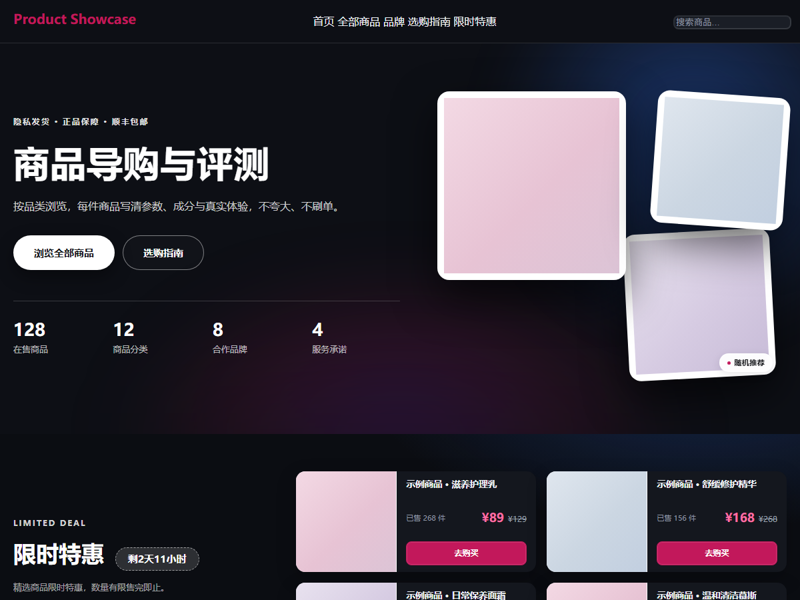
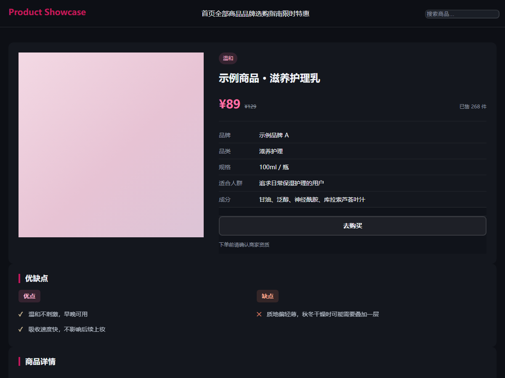
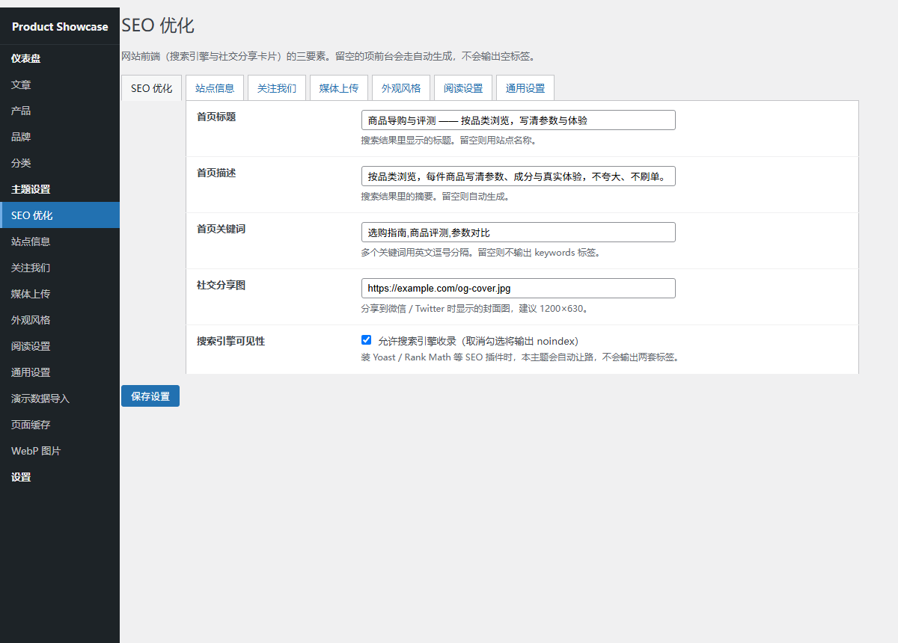

<div align="center">

# Product Showcase Guide

**WordPress 商品导购与评测主题 · 开源基础版**

[](LICENSE)
[](https://wordpress.org/)
[](https://www.php.net/)
[](CHANGELOG.md)

一个把「商品展示 + 内容评测」做在一起的 WordPress 主题。
自带商品管理、品牌/品类分类、限时特惠、SEO、整页缓存与图片优化。



</div>

---

## 界面预览

<details>
<summary><b>商品详情页</b>（点击展开）</summary>



</details>

<details>
<summary><b>后台设置</b>（点击展开）</summary>



</details>

> 预览图使用主题的真实样式渲染，数据为占位内容。

## 这个版本包含什么

基础版聚焦**内容与展示**，不包含任何交易类功能。

| 功能 | 说明 |
|---|---|
| **商品管理** | 独立的 `plm_product` 文章类型，带现价、原价、购买链接、规格、成分、优缺点、用户评价等结构化字段 |
| **品牌与品类** | `plm_brand` / `plm_category` 两套分类法，支持品牌 Logo、分类图标 |
| **商品图集** | 多图上传、排序、设主图，详情页与卡片自动取用 |
| **限时特惠** | 商品列表页勾选「首页抢购」即上首页，模块头显示倒计时（结束时间在后台配置） |
| **首页两种风格** | 货架版 / 橱窗版，后台一键切换 |
| **博客系统** | 完整的文章系统：归档、搜索、评论、相关文章、阅读量统计 |
| **SEO** | meta / Open Graph / Twitter Card / JSON-LD 结构化数据；自动检测并让位给 Yoast、Rank Math 等主流插件 |
| **整页缓存** | 未登录访客的静态型 GET 页面落盘缓存，后台可一键清空 |
| **WebP 转换** | 后台批量把媒体库图片转成 WebP |
| **图片性能优化** | 长图懒加载 + 补固有尺寸，降低 CLS 与首屏流量 |
| **演示数据导入** | 一键导入示例商品、文章与分类 |
| **站点健康自查** | 后台可查关键指标，并清理过期缓存与冗余修订版本 |

### 明确不含的功能

基础版**不包含**以下内容，也没有留任何"付费版"开关或授权校验：

- 在线支付（微信支付 / 支付宝）
- 购物车、结算与订单
- 会员体系与会员价
- 优惠券
- 物流查询
- 微信小程序后端

商品页的「去购买」按钮是一个**跳转外链**的普通链接，指向你自己填写的商品购买地址。

---

## 安装

### 方式一：后台上传（推荐）

1. 下载本仓库的 `product-showcase-guide.zip`（见 [Releases](../../releases)）
2. WordPress 后台 → **外观 → 主题 → 添加新主题 → 上传主题**
3. 选择 zip 文件 → **现在安装** → **启用**

> ⚠️ WordPress 后台上传主题时会**先删除目标主题目录再解压**。
> 演示图片请放在**媒体库**里，不要依赖主题目录 —— 详见
> `assets/imgs/post/README.txt`。

### 方式二：直接上传文件

把整个 `product-showcase-guide` 目录放进 `wp-content/themes/`，然后在后台启用。

### 安装后建议做的事

1. **导入演示数据**：后台 → 主题设置 → 演示数据导入 → 勾选导入
2. **设置站点信息**：后台 → 主题设置 → 站点信息（备案号、联系方式、合规提示）
3. **配 SEO**：后台 → 主题设置 → SEO 优化
4. **换固定链接**：设置 → 固定链接 → 选「文章名」（主题的商品详情页依赖伪静态规则）

---

## 目录结构

```
product-showcase-guide/
├── style.css                  主题头（Theme Name / Version / License 等）
├── functions.php               主题主文件：注册内容类型、模板逻辑、后台设置
├── index.php                   通用兜底模板
├── front-page.php              首页（按设置加载「货架」或「橱窗」风格）
├── home.php                    博客首页
├── header.php / footer.php     页头页脚
├── sidebar.php / searchform.php / comments.php
├── single.php                  文章详情
├── archive.php                 文章归档
├── search.php                  搜索结果
├── 404.php                     404 页
├── single-plm_product.php      商品详情页
├── archive-plm_product.php     商品归档页
├── taxonomy-plm_brand.php      品牌页
├── taxonomy-plm_category.php   品类页
├── page.php                    通用页面
├── page-sale.php               限时特惠页（/sale/）
├── page-brands.php             品牌聚合页
│
├── inc/
│   ├── core-compat.php         基础版兼容层（交易功能的降级实现）
│   ├── site-settings.php        后台设置页（SEO / 站点信息 / 通用设置等）
│   ├── demo-importer.php        演示数据导入
│   ├── seo.php                  SEO meta 与结构化数据
│   ├── page-cache.php           整页缓存
│   ├── webp.php                 WebP 批量转换
│   ├── img-perf.php             前台图片性能优化
│   ├── health.php               站点健康自查与安全清理
│   ├── product-list-edit.php    商品列表页行内编辑
│   ├── jd-import.php            详情长图导入（从电商页面抓图到媒体库）
│   ├── zhuque.php               AI 文本检测（腾讯朱雀，服务端调用）
│   ├── zhuque-admin.php         AI 检测后台界面
│   ├── home/
│   │   ├── shelf.php            首页「货架」风格
│   │   ├── showcase.php         首页「橱窗」风格
│   │   ├── card.php             橱窗风格专用商品卡
│   │   ├── list-showcase.php    橱窗风格列表区
│   │   └── countdown.php        倒计时组件
│   └── lib/qrcode.class.php     二维码生成（PHPQRCode，LGPL）
│
└── assets/
    ├── css/                     样式（含 dist/ 压缩产物）
    ├── js/                      脚本（无 jQuery 依赖）
    └── imgs/                    演示图片投放目录（建议改用媒体库）
```

### 可用的短代码

| 短代码 | 作用 |
|---|---|
| `[product_card]` | 输出商品卡片 |
| `[article_card]` | 输出文章卡片 |
| `[sales_rank]` | 输出销量排行榜 |

---

## 常见问题

**Q：商品详情页 404？**
检查「设置 → 固定链接」是否保存过。主题的商品页依赖伪静态规则，改完固定链接后访问一次任意页面即可触发刷新。

**Q：前台样式不生效 / 样式错乱？**
主题用 `?ver=` 参数做缓存失效。若改过 CSS，请清一下浏览器缓存或 WordPress 的页面缓存。

**Q：页面积累了很多缓存文件？**
后台 → 主题设置 → 页面缓存，可查看占用并一键清空。

**Q：怎么加商品？**
后台左侧「产品」菜单 → 新增。有专属的字段面板（价格、购买链接、规格、成分、优缺点、图集等）。

**Q：首页「限时特惠」区块是空的？**
需要两步：① 在「产品」列表页给商品勾上「首页抢购」；② 在「主题设置 → 通用设置」里填「限时活动结束时间」（不填则不显示倒计时，但商品仍会出现）。

**Q：能加自己的样式吗？**
可以。用子主题（Child Theme）覆盖，不要直接改主题文件 —— 主题更新会覆盖你的改动。详见下方「二次开发」。

---

## 二次开发

推荐用**子主题**，这样主题更新时你的改动不会丢：

```bash
# 1. 建子主题目录
mkdir -p wp-content/themes/my-child-theme

# 2. style.css 里写上父主题声明
cat > wp-content/themes/my-child-theme/style.css <<'EOF'
/*
Theme Name: My Child Theme
Template: product-showcase-guide
*/
EOF
```

`functions.php` 里可以挂自己的钩子：

```php
add_action( 'wp_enqueue_scripts', function () {
	wp_enqueue_style( 'my-style', get_stylesheet_uri(), array(), '1.0' );
} );
```

### 代码风格

- PHP 遵循 WordPress Coding Standards（`WordPress-Core` + `WordPress-Docs`）
- 缩进用 **Tab**，对齐用 **空格**
- 注释用中文，说明「为什么这么做」而不是「这行在做什么」
- 前台输出一律转义：`esc_html()` / `esc_attr()` / `esc_url()`
- 数据库查询用 WordPress API（`WP_Query` / `get_posts` / `$wpdb->prepare`），不要直接拼 SQL

---

## 参与贡献

欢迎提 Issue 和 PR。开始之前请先读 [CONTRIBUTING.md](CONTRIBUTING.md)。

---

## 安全

发现安全问题请**不要**开公开 Issue，参见 [SECURITY.md](SECURITY.md)。

---

## 免责声明

- 本主题是**软件工具**，不销售任何商品，也不提供任何商品推荐。
- 主题自带的演示数据（`demo-data.txt`）全部为**虚构的示例内容**，不对应任何真实商品、品牌或功效宣称；请在正式使用前替换为你自己的内容。
- 主题不包含任何第三方服务的 SDK 或密钥；`inc/zhuque.php` 里的 AI 检测接口需你自己提供 API Key（只存服务端，不下发浏览器）。
- 使用本主题产生的任何后果由使用者自行承担。

---

## 许可证

[GPL v2 or later](LICENSE) —— 这是 WordPress 主题的强制要求：所有基于 WordPress 的主题必须以 GPL 授权发布，且衍生作品必须同样开源。

---

## 更新日志

见 [CHANGELOG.md](CHANGELOG.md)。

---

## 致谢

- [WordPress](https://wordpress.org/) —— 主题运行的基础
- [PHPQRCode](http://phpqrcode.sourceforge.net/) —— `inc/lib/qrcode.class.php`（LGPL）
- [朱雀 AI 检测](https://ai-gateway.edgeone.link/) —— `inc/zhuque.php`（可选功能，需自备 Key）

欢迎提 Issue 和 PR。
